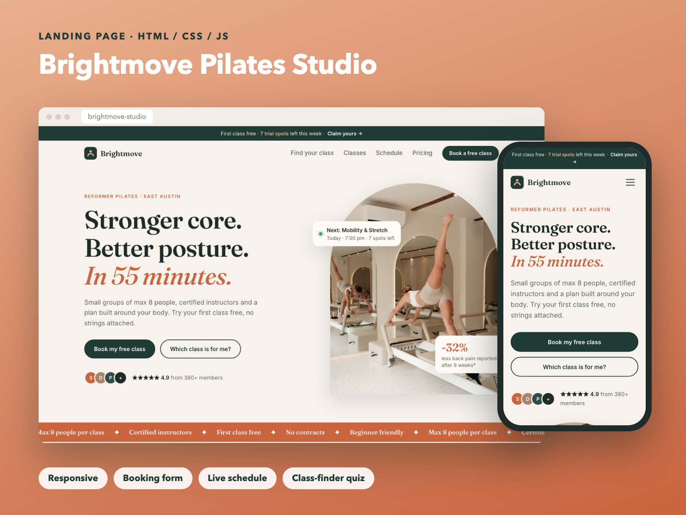

# Brightmove Studio — Landing Page

A conversion-focused landing page for a (fictional) reformer Pilates studio in Austin, TX. The goal of the page is one action: **book a free trial class**.

**Live demo:** https://woaquw.github.io/brightmove-studio/



## What makes it convert

- **"Find your class in 30 seconds" quiz:** three questions (goal, experience, preferred time) → a matched class, the reason it fits, and the next free slots at the visitor's preferred time. One click pre-fills the booking form.
- **Live "next class" card** in the hero, calculated from the schedule and the current time.
- **Urgency without tricks:** promo bar with trial spots left, "only 2 spots left" labels in the schedule.
- **Sticky "Book" button on mobile** that appears after the hero and hides when the form is on screen.
- **Social proof:** rating, member reviews, real studio photos.
- **AI assistant chat:** answers questions about classes, prices and the schedule from the studio's own data and invites visitors to book (free open-source model on Cloudflare Workers AI). Code: [brightmove-chat](https://github.com/woaquw/brightmove-chat).

## Features

- **Interactive schedule:** day tabs (opens on today), 12-hour US time, spots left, full classes disabled, arrow-key navigation.
- **Booking form:** inline validation with clear messages, spam honeypot, loading and success states; demo mode or real submissions to any form backend.
- **Responsive:** tested at 375 px (phone), 768 px (tablet) and desktop widths, with a mobile menu.
- **Fast:** plain HTML, CSS and JavaScript, no frameworks or build step. Responsive images (`srcset`), lazy loading below the fold, hero image prioritized.
- **Accessible:** semantic HTML, labels on every field, visible focus, skip link, `aria` states, respects "reduce motion".
- **SEO basics:** meta description, Open Graph tags, schema.org local business data.

## Receive real form submissions

Create a free form on [Formspree](https://formspree.io) (or a similar service) and put its URL in `index.html`:

```html
<form ... data-endpoint="https://formspree.io/f/your-id">
```

With an empty `data-endpoint` the form runs in demo mode and only shows the success message.

## Run locally

```bash
python3 -m http.server 8000
```

Then open http://localhost:8000.

## Customize

- Colors and fonts: CSS variables at the top of `styles.css`.
- Schedule, class descriptions and quiz logic: `script.js` (`SCHEDULE`, `CLASSES`, `pickClass`).
- Texts and prices: `index.html`.

Photos from [Unsplash](https://unsplash.com). The studio, people and reviews are fictional; this is a portfolio project.
